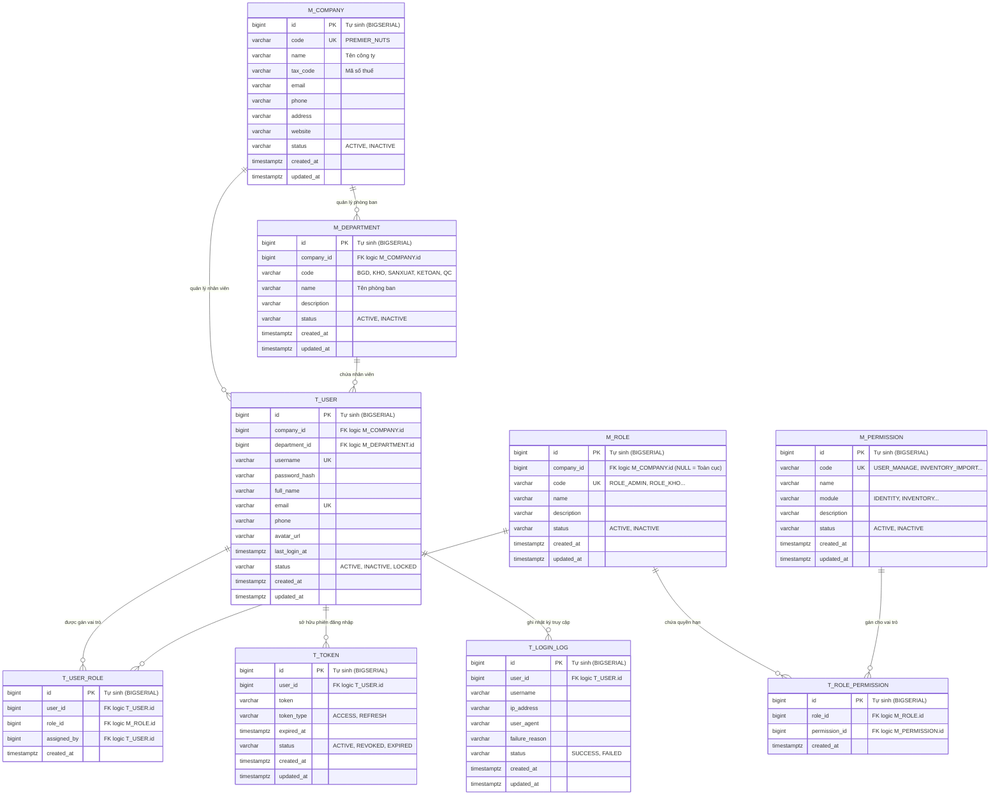

# BẢN VẼ THIẾT KẾ ERD - PHÂN HỆ IDENTITY & AUTHENTICATION (PREMIER NUTS ERP)

## 1. Cấu trúc phân cấp Doanh nghiệp (Enterprise Hierarchy)
Mô hình tổ chức xuất phát từ cấp cao nhất là Doanh nghiệp/Công ty đi xuống:
```
M_COMPANY (Công ty: Premier Nuts)
   ├── M_DEPARTMENT (Phòng ban: BGD, Kho Vận, Sản Xuất, Kế Toán, QC)
   │      └── T_USER (Nhân viên / Người dùng)
   └── M_ROLE (Vai trò / Quyền hạn trong doanh nghiệp)
```

## 2. Quy ước chuẩn hóa Database
* **Tên bảng VIẾT HOA TOÀN BỘ**:
  * **`M_` (Master Tables)**: Bảng danh mục nền tảng (`M_COMPANY`, `M_DEPARTMENT`, `M_ROLE`, `M_PERMISSION`).
  * **`T_` (Transaction Tables)**: Bảng nghiệp vụ biến động (`T_USER`, `T_TOKEN`, `T_LOGIN_LOG`).
* **Bảng trung gian (Junction Tables)**: `T_USER_ROLE`, `T_ROLE_PERMISSION` (chỉ lưu các ID logic và `created_at`).
* **Trường chuẩn hóa Audit**: Mọi bảng (trừ bảng trung gian) đều có bộ 3 trường: `status`, `created_at`, `updated_at`.
* **ID tự sinh 100% (Auto-generated ID)**: Sử dụng kiểu `BIGSERIAL PRIMARY KEY` trong PostgreSQL. Dữ liệu seed hoàn toàn để database tự sinh sequence ID, không chèn cứng ID thủ công.
* **Khóa ngoại Logic**: Có liên kết logic giữa các bảng nhưng **không tạo ràng buộc FOREIGN KEY ở mức DB** để tối ưu hiệu năng. Chưa tạo index theo yêu cầu.

---

## 3. Sơ đồ Thực thể Liên kết (Mermaid ERD)


